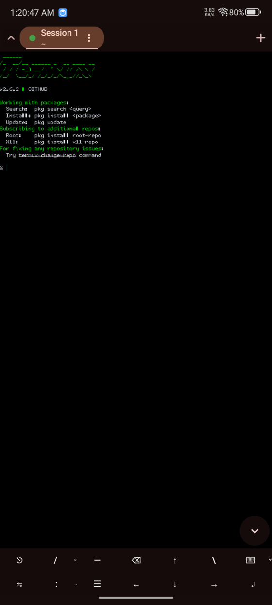
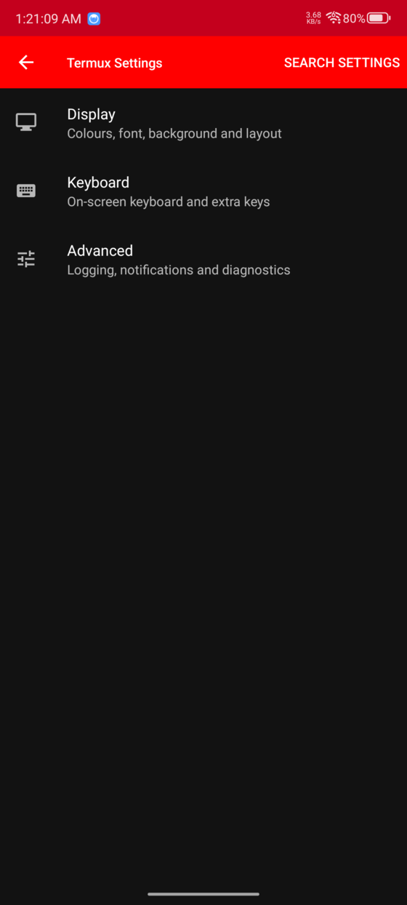
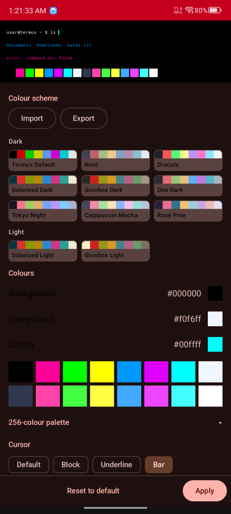

# Termux

Termux is a terminal emulator and Linux environment for Android. This repository holds the app
itself: the interface you tap and the terminal emulation behind it. The packages you install
inside Termux live in [termux/termux-packages](https://github.com/termux/termux-packages).

The app began as [GeneralKaos666's fork](https://github.com/GeneralKaos666/termux-app) of
[upstream termux/termux-app](https://github.com/termux/termux-app) and now stands on its own. The
interface is rebuilt on Kotlin and Jetpack Compose, and the codebase diverges deliberately, with
no plan to merge back.

## Screenshots

| Terminal | Settings | Appearance |
|---|---|---|
|  |  |  |

## What this app adds

- **Sessions bar** across the top, about 40dp tall: tap a tab to switch, long-press and drag to
  reorder, and rename, close or move a session from its own tab menu (⋮). A chevron collapses the
  bar to a small restore handle; tap that to bring it back.
- **Three-page extra-keys bar** below the terminal, swiped left and right:
  1. a key grid (the classic Termux extra keys),
  2. a **second key grid with its own layout**, and
  3. a **text-send field** with a back arrow that returns to the first grid.
  A chevron floating on the bar collapses the keys; while collapsed the same chevron becomes the
  restore handle. Both grids are the standard `ExtraKeysView` engine, so custom layouts, modifier
  keys, swipe-up popups and long-press repeat behave exactly as upstream.
- **Extra-keys presets** in Settings → Keyboard, independent for each grid: a **Preset** picker
  for the first page (Default, Compact, Vim, Emacs) and a **Second page preset** picker for the
  second (Default, Function). A custom `extra-keys` or `extra-keys-page2` property in
  `~/.termux/termux.properties` always overrides the preset.
- **Appearance screen** from the terminal's Style menu (Settings → Display → Style → Appearance):
  eleven colour presets, an editor for the background, foreground, cursor and all 256 indexed
  colours (the sixteen ANSI colours plus a collapsible 256-colour palette), font and size, and
  cursor style and blink, all with a live preview. Both cursor settings can be left at their
  Default, which follows `termux.properties`. It replaces the separate Termux:Styling app.
- **Wallpaper backgrounds**: follow the system wallpaper or an image of your own. Only a static
  image is read, so a live wallpaper will not work.
- **Floating terminal** (Termux:Float folded into the app, no separate APK): a draggable bubble that
  expands into a movable, resizable window over `TerminalView`, running its own session.
  Enter it from the sessions-bar "+" menu ("New floating session"), or toggle it from the foreground
  notification's "Float" action.
- **First-run walkthrough** on a fresh install, leading into the bootstrap package install. It
  shows only while there are no sessions, and does not return once the bootstrap is installed.
- **Engine upgrades** in the terminal itself: tap-to-open `OSC 8` hyperlinks, per-cell coloured
  underlines (`SGR 58`), richer underline styles, ligatures and grapheme shaping (on by default,
  toggle in Appearance), a first cut of the kitty graphics protocol, and a renderer that redraws
  only what changed.

Most work lands in `:app`, but the engine upgrades also change `:terminal-emulator` and
`:terminal-view`.

## Install

Take an APK from [Releases](https://github.com/GeneralKaos666/termux-app/releases), currently
`v2.6.3`, or from the
[Build workflow](https://github.com/GeneralKaos666/termux-app/actions/workflows/debug_build.yml),
where the tip of `master` is always built:

1. Download from the releases page, or open Build, pick the latest successful run on `master`,
   and download an APK from it. Artifact downloads require you to be logged into a GitHub account.
2. Pick the variant that matches your device: `apt-android-7` for Android 7 and above,
   `apt-android-5` for devices that need the older package bootstrap. Both APKs require Android
   6.0 (minSdk 23). Inside a variant, grab the `universal` APK, or the smaller one for your
   architecture (`arm64-v8a`, `armeabi-v7a`, `x86_64`, `x86`).
3. Uninstall every Termux app and plugin already on the device before installing. The app
   keeps the `com.termux` shared user ID, so its APKs must carry the same signature as
   everything else that runs under that ID. F-Droid, Play and upstream GitHub builds use
   different keys, and plugins installed from another source will refuse to work alongside
   this one.
4. Allow your browser or file manager to install unknown apps, then open the APK.

The release APKs are signed with this repository's release key and are not debuggable. Treat
APKs from anywhere other than this repository's releases and Actions pages as untrusted. A build
signed with a different key cannot be upgraded in place: uninstall the previous app first.

## Using it

Run `pkg install <package>` to add tools, `pkg update` to upgrade. The
[package management wiki page](https://wiki.termux.dev/wiki/Package_Management) covers
repositories and fixes for `repository is under maintenance or down` errors. General help
sits on the [Termux wiki](https://wiki.termux.dev/).

## Backup and restore

`scripts/termux-backup` backs up `$HOME`, `$PREFIX/etc` and the installed package list, and restores
them on the same device or a new one. It writes a verified, checksummed archive, snapshots the
current environment before every restore, and reinstalls missing packages afterwards. See
[`scripts/termux-backup/README.md`](scripts/termux-backup/README.md) for install, commands and the
new-device walkthrough.

The same tool is in the app: **Settings → Advanced → Backup & restore** provisions the script into
`$PREFIX/lib/termux-backup` on first open, creates, verifies, restores, deletes and prunes backups,
and exports or imports a backup directory through the system file picker. Restores show a
confirmation, keep a safety archive by default, and ask for an app restart afterwards.

## Android 12 and above

Android kills background and CPU-hungry processes aggressively, so a shell can die with
`[Process completed (signal 9) - press Enter]` without you exiting it. Upstream tracks the
problem and its workarounds in
[termux-app#2366](https://github.com/termux/termux-app/issues/2366).

## What's coming

These are the pieces still in progress or up next.

- **Three colour presets need a human look on a real phone.** Solarized Light, Gruvbox Dark and
  One Dark have had a measured contrast pass but not the aesthetic one. The checklist is in
  `docs/ledger/manual-checks.md` (D-5).
- **The rest of xterm conformance.** The engine program ships on `master` today: the cell model,
  the dirty-region renderer, run shaping with ligatures, a kitty-graphics subset, and tap-to-open
  `OSC 8` hyperlinks with `SGR 58` coloured underlines. All of it is checked on device except the
  API 21 to 28 legacy shaping path, which has no device to run on. What remains is the unspecified
  rest of xterm conformance, still parked and unspecced.
- **Session restore** (recorded only, needs a spec). A running shell cannot outlive the app process.
  Realistic durability means snapshotting sessions and respawning them opt-in on the next launch.
  Assessed as more work than value right now, so it stays deferred in
  `docs/ledger/outstanding-work.md` §1.1 / §5.1.
- **Device checks come last.** Every remaining device and manual check is listed in
  `docs/ledger/manual-checks.md`; the rest of the not-yet-done work is in
  `docs/ledger/outstanding-work.md`.

## License and security

Code is [GPLv3 only](LICENSE.md), with Apache 2.0 exceptions for the terminal emulator and
view libraries. Report vulnerabilities per [termux.dev/security](https://termux.dev/security);
see also [SECURITY.md](SECURITY.md).
